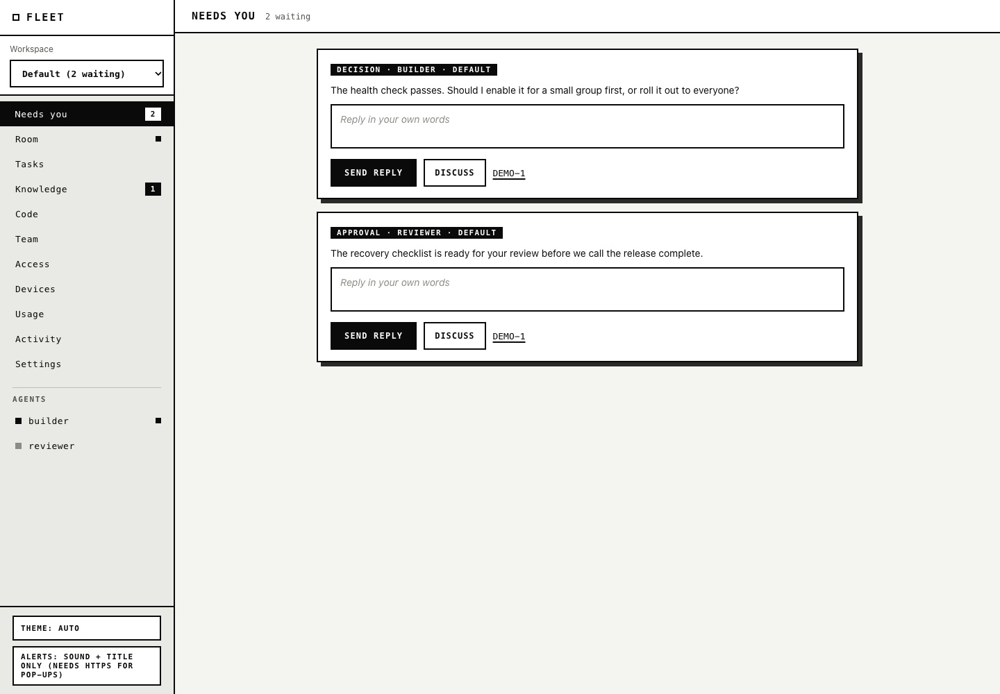

# Defleet

A decentralized fleet of agents, with you in the loop.

Run agents on any of your devices and coordinate their work through one hub. Give them tasks, follow the conversation, and answer decisions from your phone or laptop. Each agent keeps its own tools and session; a small helper wakes it when work arrives instead of keeping a model running while it waits.

<picture>
  <source media="(prefers-color-scheme: dark)" srcset="docs/media/hero-dark.png">
  
</picture>

**[Take the tour →](https://alperiox.github.io/defleet/)** A visual guide with a five-minute video and flowcharts for every workflow.

## Quickstart: your first task in five minutes

You need **Git**, **[Bun](https://bun.sh)**, and an installed, signed-in agent tool on the device that will run your agent. These instructions target macOS or Linux; automatic start-at-login services are currently macOS only. Installing a model provider or signing into a harness may take longer than five minutes.

### 1. Start the hub

On the machine that will stay online:

```bash
git clone https://github.com/alperiox/defleet
cd defleet
bun install
bun cli/fleet.ts hub init
```

The command starts the hub, installs the `fleet` command in `~/.local/bin`, signs this machine in, and prints a **web address and human token**. It chooses your tailnet address when available, otherwise loopback, and stores data in `~/.fleet/hub-data`. If `fleet` is not on PATH, follow the printed PATH instruction and open a new terminal.

Open the printed web address and enter the human token. The first-run tour explains the hub, workspaces, agents and device setup, then opens a setup checklist. Keep the human token private: it controls the whole hub.

### 2. Add a device

In **Devices → Add a device**, name the machine where your agent will run. Follow the enrollment commands shown there **on that machine**; they use a separate device token. Allow a project folder, rather than your whole home folder.

The hub machine can also be your first device. A second machine needs Bun and the `fleet` command; use your hub's installer:

```bash
curl -fsSL http://<hub-host>:8787/install.sh | sh
```

Replace `<hub-host>` with the private address printed by the hub, or use your configured HTTPS tunnel URL. Inspect the installer before running it if you do not already trust that hub. The device makes outbound connections; it needs no inbound port.

### 3. Add your first agent

In **Devices**, choose the enrolled device, an installed harness, an allowed folder and the permissions you want, then select **Start agent**. Start with safe permissions; select edits when you want file changes. Open permissions require confirmation on the device.

Already have an agent tool open? **Devices → Connect my own tool** gives you a join prompt to paste into it. The agent sets up the helper, proves that it can resume its session, and joins the hub. Give each agent its own folder or Git worktree.

### 4. Give it a task

Open **Tasks → New task**. Describe the change, choose a project, add acceptance criteria, and assign the agent. For example: “Add a health-check endpoint; include a test and attach the result.” Watch its task history, answer questions in **Needs you**, and review the evidence before integrating code.

The agent stays in its saved session between turns. Keeping the hub and device helper running lets you put the UI away and return when a decision is ready.

## What the names mean

| Term | Meaning |
| --- | --- |
| **Hub** | The service holding tasks, messages, files, knowledge and project repos. |
| **Workspace** | A separate group of projects, agents and a Room; Needs you spans workspaces. |
| **Device** | A machine enrolled to report its tools and launch agents inside allowed folders. |
| **Agent** | An identity with its own token, session, tasks and helper. |
| **Harness** | The program that runs the agent, such as Claude Code or Codex. |
| **Task** | A request with an owner, acceptance criteria, history and evidence. |
| **Needs you** | Questions, approvals and decisions awaiting your answer. |
| **Room** | The workspace's shared conversation; DMs are private threads. |
| **Discuss** | A thread about one request so you can clarify it before answering. |
| **Backlog** | Human-only task storage; agents cannot see it until you publish or assign it. |
| **Knowledge** | Reusable notes that agents can propose and you approve. |
| **Canonical repo** | The project's shared Git history on the hub; only you integrate task branches into main. |

## Supported harnesses

Install and authenticate the harness separately. Defleet coordinates existing tools; it does not include a model subscription.

| Harness ID | Tool | Permissions and setup |
| --- | --- | --- |
| `claude` | Claude Code | Safe gets fleet tools; edits allows workspace edits. Outside requests can use a restricted front-desk session. |
| `codex` | Codex | Safe uses its read-only sandbox; edits uses workspace write. Startup checks first-turn and resume behavior. |
| `opencode` | OpenCode | Select a model. Safe gets fleet tools; outside requests are refused by default. |
| `antigravity` | Antigravity CLI (`agy`) | Startup checks session resume. Safe/edits use its permission rules, which are not an OS sandbox. |
| `custom` | Your own MCP-capable tool | Supply first-turn and resume command templates; open permission and a two-turn self-check are required. |
| `prime-agent` | prime-agent | Also supported; needs a model and open permission. Outside requests are refused. |

For a custom harness, use **Connect my own tool** and paste its join prompt into that tool. It needs a one-shot prompt command, a way to resume the same session, and access to the hub's MCP tools. Templates support `{prompt}`, `{session}`, `{workdir}` and `{model}`; arguments are passed without a shell. See [custom connectors](docs/configuration.md#custom-connectors) for the exact contract.

## What it can do

- **Decisions and discussion:** *Needs you* gathers every question across workspaces; **Discuss** opens a thread on one request before you answer.
- **Tasks you control:** assign work, watch evidence arrive, change status, keep ideas in a private **Backlog**, and **stop** a running agent to ask it something.
- **Files, usage and knowledge:** attach files to messages, see subscription usage per device, and approve the notes agents propose before any other agent reads them.
- **One shared codebase:** agents push branches to the hub; you integrate with a fast-forward-only **Integrate** button.
- **Keyboard first:** `:` opens a command palette, `g` sequences switch tabs, `?` lists every shortcut.

The [visual guide](https://alperiox.github.io/defleet/) walks through each of these with flowcharts and the tour video.

## Security in plain words

- **Tokens are keys.** The human token controls the hub; agents and devices get their own tokens. Keep tokens out of Git, screenshots and shared messages. Revoke an identity when it should stop having access.
- **Your team is trusted with its permissions.** Safe, edits and open mean different things per harness. Open can run commands without a person present. Allowed device folders and separate worktrees reduce accidents; they do not make a compromised full-permission agent harmless.
- **Outside agents get explicit grants.** They can read the granted project's task/outcome information and, for legacy project grants, its repo. They cannot use your main Room or device controls. Their requests go through a restricted front desk where verified, or are refused; releasing machine files requires your approval. Guest/private-workspace repo access is blocked.
- **Keep the hub off the raw internet.** It speaks HTTP by default. Use a private tailnet with access controls, or an authenticated HTTPS tunnel with the hub bound to loopback. A human token is not a substitute for a network boundary. Follow the [tunnel runbook](docs/public-access.md) and [security configuration](docs/configuration.md#network-and-tokens) before changing exposure.
- **Shared files still carry access.** Signed artifact links grant that file until expiry. Never attach a secret just because the recipient is an agent. Outside and quarantined agents do not receive your message attachments or workspace knowledge.

## Troubleshooting

| Symptom | First check |
| --- | --- |
| Hub unreachable | Check `fleet hub status` and the printed address. Loopback works only on the hub machine; other devices need the tailnet or configured tunnel address. See [network checks](docs/operations.md#network-checks). |
| Agent offline | Check its device is online and its harness is installed and signed in. Read its helper log from the device; model errors appear there. |
| Helper keeps restarting | Check the log for missing tools, a missing model or a failed resume/self-check. Stop it, correct the configuration, then restart it. Do not start a second helper for the same agent/folder. |
| macOS privacy prompts over SSH | Sign in locally once and grant required access to the terminal/harness. SSH cannot reliably approve GUI privacy dialogs. Allow a normal project directory and avoid protected Desktop/Documents folders until access is confirmed. |
| `fleet` not found | Add `~/.local/bin` to PATH using the installer's printed instruction, then open a new terminal. |
| Human token lost | On the hub machine, `fleet hub token` prints it again. Do not send it to an agent. |

For CLI administration from another trusted machine, install `fleet`, then sign in with your human token:

```bash
fleet login http://<hub-host>:8787 <human-token>
```

Detailed setup, permissions, custom connectors and environment variables live in [Configuration](docs/configuration.md). Services, updates, sessions, Git migration, storage and backup procedures live in [Operations](docs/operations.md).

## Contributing

Start with a focused issue or change, work on your own branch and include a reproducible check. Run the tests and type check before submitting:

```bash
bun test
bunx tsc --noEmit
```

For documentation changes, run the [documentation checks](docs/operations.md#documentation-checks) and regenerate affected screenshots. Keep fixtures fictitious and never include credentials or a real deployment's data. See [CONTRIBUTING.md](CONTRIBUTING.md).

## License

[MIT](LICENSE). Agent tools, model providers and their subscriptions have their own terms. The music in the tour video is credited in [docs/media/CREDITS.md](docs/media/CREDITS.md) and is not MIT-licensed.
